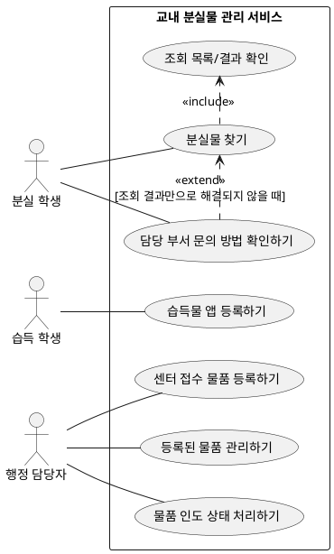

# 교내 분실물 관리 서비스 유스케이스 UC v0.1

## 1. 목적 및 모델링 기준

유스케이스는 사용자가 서비스와 상호작용해 달성하려는 하나의 목표 단위로 식별한다. 화면 조작이나 필드 입력 같은 세부 단계는 별도의 유스케이스로 나누지 않는다. `<<include>>`는 기본 유스케이스가 수행될 때 항상 필요한 행위를, `<<extend>>`는 정해진 조건에서 선택적으로 추가되는 행위를 나타낸다.

습득물 등록은 두 개의 서비스 단위로 확정한다. 습득 학생은 습득한 물품을 앱으로 바로 등록하고, 행정 담당자는 분실물 센터로 접수된 습득 물품을 관리하기 위해 등록한다. 기존의 행정 담당자 등록 요구를 유지하면서 학생 앱 등록 경로를 추가한 결정이며, 고객 요구사항 및 SRS에도 반영했다.

## 2. 액터 목록

| 액터 | 유형 | 달성하려는 목표 | 근거 및 상태 |
|---|---|---|---|
| 분실 학생 | 주 액터 | 방문 전에 물품이 등록되어 있는지, 보관 중인지와 위치가 어디인지 확인하고 필요하면 담당 부서에 문의한다. | NEEDS_1, NEEDS_4; S1 |
| 습득 학생 | 주 액터 | 습득한 물품을 앱으로 바로 등록해 분실 학생이 찾을 수 있게 한다. | 확정된 등록 경로; NEEDS_2, SC2 |
| 행정 담당자 | 주 액터 | 분실물 센터에 접수된 물품을 등록하고, 등록 정보 및 보관·인도 상태를 관리해 반복 문의와 관리 부담을 줄인다. | NEEDS_2, NEEDS_3, NEEDS_7; S2, SC2 |
| 정보보호 담당자 | 이해관계자 | 조회 화면의 공개 정보 범위를 검토한다. 현재 서비스 내 직접 수행 기능은 정의되지 않았다. | NEEDS_6; S4 |
| 서비스 운영 책임자 | 이해관계자/후보 액터 | 운영 정책과 운영 책임을 결정한다. 실제 담당자 및 서비스 내 상호작용은 미정이다. | 고객 요구사항 이해관계자 표 |

습득물 접수 위치 안내는 SC4에서 범위 미정이므로 액터의 목표로 기록하되, 현재 확정 유스케이스에는 포함하지 않는다. 학교 인증 시스템, 사진 매칭 시스템 및 자동 알림 시스템은 범위에서 제외한다.

## 3. 유스케이스 목록

| ID | 유스케이스 | 주 액터 | 사용자 목표: 무엇을, 왜 | 관련 요구사항/상태 |
|---|---|---|---|---|
| UC_01 | 분실물 찾기 | 분실 학생 | 물품을 검색하고 보관 여부와 위치를 확인해 행정실을 불필요하게 방문하지 않는다. | NEEDS_1, SC1, FR_00, FR_01 |
| UC_02 | 담당 부서 문의 방법 확인하기 | 분실 학생 | 조회 결과만으로 해결되지 않을 때 보관 담당 부서에 연락할 경로를 알아낸다. | NEEDS_4, SC6, FR_02. UC_01의 조건부 확장 후보 |
| UC_03 | 습득물 앱 등록하기 | 습득 학생 | 습득한 물품을 앱으로 바로 등록해 분실 학생이 조회할 수 있게 한다. | NEEDS_2, SC2, FR_03 |
| UC_04 | 센터 접수 물품 등록하기 | 행정 담당자 | 분실물 센터로 접수된 습득 물품을 등록해 센터의 물품 관리와 분실물 조회에 반영한다. | NEEDS_2, SC2, FR_06 |
| UC_05 | 등록된 물품 관리하기 | 행정 담당자 | 등록된 물품 정보를 관리해 조회 정보가 업무 상태와 맞도록 유지한다. | FR_04. 관리 범위·권한은 TBD_01 |
| UC_06 | 물품 인도 상태 처리하기 | 행정 담당자 | 물품을 인도한 뒤 상태를 인도 완료로 기록해 보관 중인 물품과 구분한다. | NEEDS_3, SC3, FR_05, Pol_04 |

## 4. 유스케이스 상세

### UC_01 분실물 찾기

| 항목 | 설명 |
|---|---|
| 주 액터 | 분실 학생 |
| 목표 | 방문 전에 잃어버린 물품의 등록 여부, 보관 여부와 위치를 확인한다. |
| 시작 조건 | 분실 학생이 분실물 조회를 시작한다. |
| 기본 흐름 | 1. 학생이 분실물 조회를 요청한다. 2. 서비스가 조회 가능한 분실물 정보를 보여준다. 3. 학생이 물품을 식별할 수 있는 정보를 살펴본다. 4. 서비스가 해당 물품의 보관 여부와 위치를 제공한다. |
| 대안 흐름 | 일치하는 물품을 찾지 못하면 서비스는 조회 결과가 없음을 알린다. 구체적인 후속 안내는 Q_03에서 결정한다. |
| 종료 조건 | 학생이 물품의 등록 여부, 보관 여부와 위치를 확인하거나 결과가 없음을 확인한다. |
| 포함 관계 | `분실물 찾기`는 물품 목록/검색 결과를 확인하는 행위를 항상 포함한다. 공개 가능한 정보와 검색 조건은 TBD_00에서 확정한다. |
| 확장 관계 | 조회만으로 해결되지 않는 경우 `담당 부서 문의 방법 확인하기`가 선택적으로 확장될 수 있다. 확장 조건 및 결과 없음 화면에 문의 안내를 표시할지는 Q_03 확인이 필요하다. |

### UC_02 담당 부서 문의 방법 확인하기

| 항목 | 설명 |
|---|---|
| 주 액터 | 분실 학생 |
| 목표 | 담당 부서에 문의할 수 있는 공식 경로를 확인한다. |
| 시작 조건 | 학생이 문의 방법 안내를 선택한다. UC_01에서 물품을 확인하지 못한 경우 시작할 수 있다. |
| 기본 흐름 | 1. 학생이 문의 방법 안내를 연다. 2. 서비스가 확정된 담당 부서 및 문의 방법을 표시한다. |
| 종료 조건 | 학생이 안내된 문의 경로를 확인한다. |
| 제약 | 개인 휴대전화 번호를 공개하지 않는다(Pol_03). 부서명·공용 연락 수단·운영 시간 등 구체 항목은 TBD_03에서 확정한다. |

### UC_03 습득물 앱 등록하기

| 항목 | 설명 |
|---|---|
| 주 액터 | 습득 학생 |
| 목표 | 습득 물품을 등록해 분실 학생이 조회할 수 있게 한다. |
| 시작 조건 | 습득 학생이 앱의 물품 등록 기능을 이용한다. 로그인이나 인증 필요 여부는 미정이다. |
| 기본 흐름 | 1. 습득 학생이 앱에서 물품 등록을 시작한다. 2. 서비스가 등록 항목을 제공한다. 3. 학생이 물품 정보를 입력해 제출한다. 4. 서비스가 등록 결과를 알린다. |
| 종료 조건 | 물품 정보가 등록되거나 입력 오류가 안내된다. |
| 미확정 사항 | 등록 필수 항목, 인증·승인/검토 절차, 실제 물품의 보관 장소, 등록자 개인정보 및 오등록 대응은 Q_01에서 확인한다. 사진 등록은 현재 범위에서 제외한다(Pol_05). |

### UC_04 센터 접수 물품 등록하기

| 항목 | 설명 |
|---|---|
| 주 액터 | 행정 담당자 |
| 목표 | 분실물 센터로 접수된 습득 물품을 물품 관리 대상에 등록한다. |
| 시작 조건 | 습득 물품이 분실물 센터에 접수된다. |
| 기본 흐름 | 1. 행정 담당자가 접수된 물품의 등록을 시작한다. 2. 서비스가 등록 항목을 제공한다. 3. 담당자가 물품 정보를 입력하고 저장한다. 4. 서비스가 등록 결과를 알린다. |
| 종료 조건 | 센터 접수 물품이 관리 및 조회 대상에 등록된다. |
| 미확정 사항 | 등록 필수 항목과 앱 등록 건과의 중복 확인 방법은 Q_02에서 확인한다. |

### UC_05 등록된 물품 관리하기

| 항목 | 설명 |
|---|---|
| 주 액터 | 행정 담당자 |
| 목표 | 등록 정보가 실제 물품 관리에 활용되도록 조회하고 필요한 관리 작업을 한다. |
| 기본 흐름 | 1. 행정 담당자가 관리 대상 물품을 조회한다. 2. 서비스가 물품 정보를 제공한다. 3. 담당자가 허용된 관리 작업을 수행한다. |
| 종료 조건 | 물품 정보가 확인 또는 갱신된다. |
| 미확정 사항 | 앱 등록 건과 센터 등록 건 각각에 대한 담당자 수정·삭제 권한 및 FR_04의 관리 범위는 Q_03에서 확정한다. |

### UC_06 물품 인도 상태 처리하기

| 항목 | 설명 |
|---|---|
| 주 액터 | 행정 담당자 |
| 목표 | 인도된 물품을 보관 중인 물품과 구별한다. |
| 기본 흐름 | 1. 담당자가 대상 물품을 조회한다. 2. 담당자가 인도 완료 상태로 기록한다. 3. 서비스가 변경된 상태를 저장하고 조회 정보에 반영한다. |
| 종료 조건 | 물품이 보관 중 또는 인도 완료로 구분되어 조회된다. |
| 미확정 사항 | 인도 확인 방법, 오기록 정정 권한 및 이력 보존은 TBD_02에서 확정한다. |

## 5. 유스케이스 다이어그램

`<<include>>`는 조회 결과 확인이 분실물 찾기의 필수 부분이라는 뜻이다. `<<extend>>`는 문의 방법 확인이 조회 때마다 필수로 수행되는 것이 아니라, 조회만으로 해결되지 않을 때 선택적으로 이어질 수 있다는 뜻이다. 확장 조건은 고객 확인 전까지 제안으로 본다.

## 6. 고객에게 확인할 질문

| ID | 질문 | 확인 이유 |
|---|---|---|
| Q_01 | 습득 학생이 앱으로 등록할 때 필수 입력 항목, 로그인/인증, 승인/검토 절차, 실제 물품 보관 및 오등록 대응은 어떻게 정할까요? | UC_03, FR_03. 학교 인증 연동은 제외됨 |
| Q_02 | 분실물 센터에 접수된 물품을 등록할 때 필수 입력 항목은 무엇이며, 앱 등록 건과 중복 여부를 어떻게 확인할까요? | UC_04, FR_06 |
| Q_03 | 행정 담당자는 앱 등록 건과 센터 등록 건에 대해 각각 어떤 수정·삭제·관리 권한을 가져야 하나요? | UC_05, FR_04, TBD_01 |
| Q_04 | 분실물 조회 결과가 없거나 물품을 확정하지 못한 경우 담당 부서 문의 방법을 안내할까요? 문의 안내는 조회 흐름에 항상 표시할까요, 사용자가 선택할 때만 표시할까요? | UC_02의 `<<extend>>` 확장 조건을 확정하기 위함 |
| Q_05 | `분실물 찾기` 결과에 보관 상태와 위치 외에 어떤 정보를 공개할까요? 검색 조건은 무엇으로 할까요? | 공개 범위와 검색 조건이 TBD_00 |
| Q_06 | 문의 안내에 표시할 부서명, 공용 연락 수단 및 운영 시간은 무엇인가요? 개인 휴대전화 번호는 공개하지 않는 정책을 유지합니다. | FR_02 및 TBD_03의 구체화 |
| Q_07 | 인도 완료 처리는 누가 어떤 확인을 거쳐 수행하고, 잘못 기록한 경우 누가 정정할 수 있나요? | UC_06, TBD_02 구체화 |
| Q_08 | 습득물을 맡길 장소 안내(SC4)는 이번 서비스 범위에 포함하나요? 포함한다면 안내 내용의 출처와 관리 책임자는 누구인가요? | SC4는 고객 문서에서 미정 |

## 7. 제외 범위

| 항목 | 처리 근거 |
|---|---|
| 사진을 업로드해 유사 분실물을 자동 매칭 | SC5 및 Pol_05에 따라 제외 |
| 사진 매칭 결과 자동 알림 | SC7 및 Pol_06에 따라 제외 |
| 개인 휴대전화 번호 공개 | SC8 및 Pol_03에 따라 제외 |
| 학교 인증 시스템 연동 | C_1 및 Pol_02에 따라 제외 |
